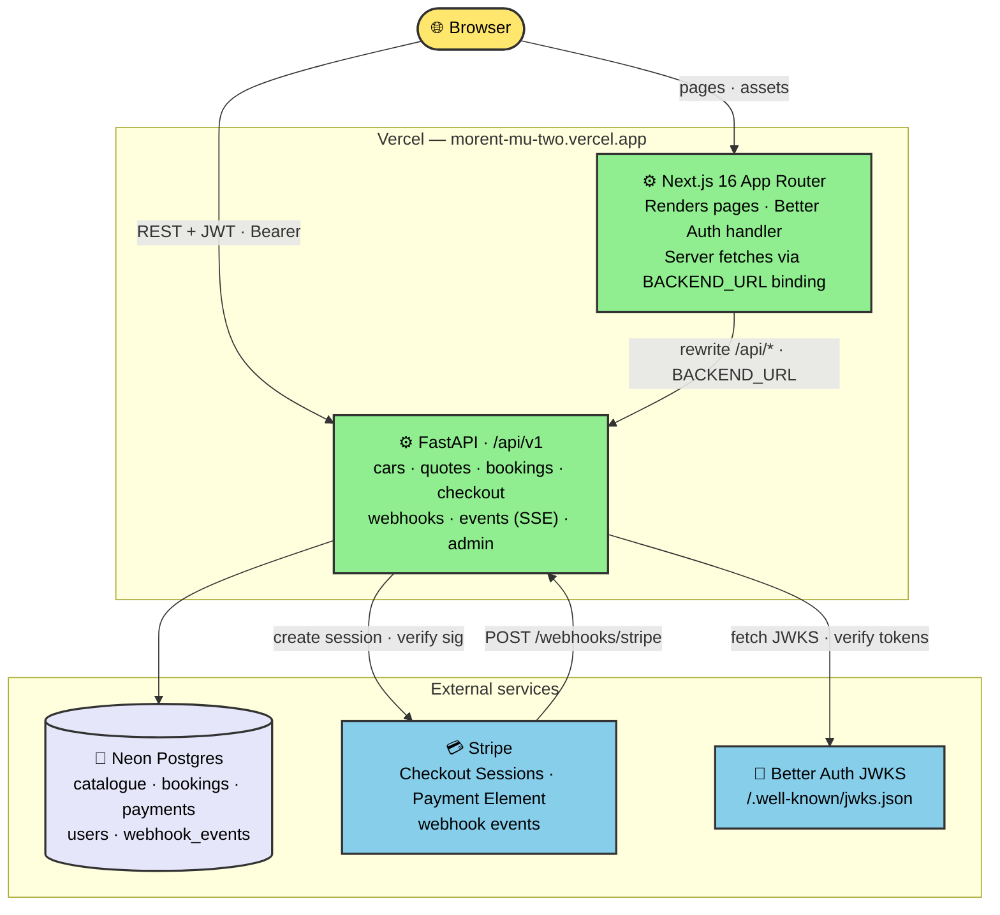
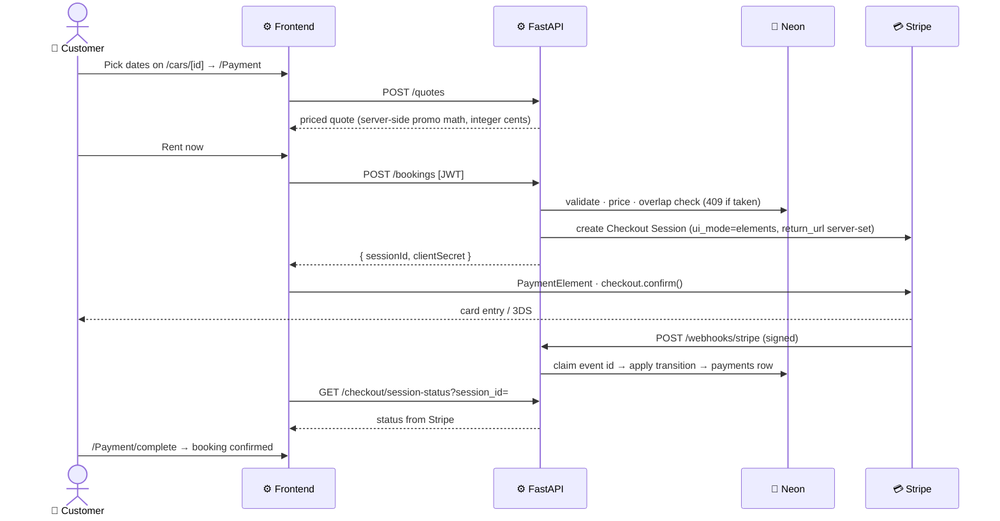

# Morent

> Full-stack car-rental web app — Next.js 16 frontend, FastAPI backend, Neon Postgres, self-hosted Better Auth, and Stripe payments with webhook fulfillment.

[](https://github.com/Mhammadkhan17/Morent/actions/workflows/ci.yml)
[](https://morent-mu-two.vercel.app)

**Live demo:** [morent-mu-two.vercel.app](https://morent-mu-two.vercel.app) · Payments run in **Stripe test mode** (use card `4242 4242 4242 4242`).

## About

Morent is a complete car-rental application built to demonstrate end-to-end full-stack craft. Every layer is inspectable and hand-built rather than delegated to a black-box BaaS:

- **Auth** — self-hosted [Better Auth](https://www.better-auth.com/) in Next.js; FastAPI verifies JWTs via JWKS
- **Payments** — Stripe Checkout Session + Payment Element; fulfillment driven by signature-verified webhooks with durable idempotency
- **Database** — Neon Postgres with SQLModel + Alembic migrations; CI runs `alembic upgrade head` + `alembic check` on every PR
- **Realtime** — in-process SSE event hub for notifications and booking messages

The demo flows work end to end: browse → quote → book → pay → manage, with distinct **customer** and **owner** roles.

## Tech stack

| Layer | Choice |
|-------|--------|
| Frontend | Next.js 16 (App Router), React 19, TypeScript, Tailwind CSS, shadcn/ui |
| Backend | FastAPI, SQLModel, Alembic, uv, ruff, pytest |
| Database | Neon Postgres (pooled for app traffic, unpooled for migrations) |
| Auth | Better Auth (self-hosted) + JWKS verification in FastAPI |
| Payments | Stripe Payment Element + webhooks (test mode) |
| Hosting | Vercel (services layout: frontend + backend in one project) |

## Architecture



Auth is carved out of the API rewrite (`/api/auth/*` → frontend) so Better Auth's route handler serves its own endpoints while everything else under `/api/*` reaches FastAPI.

## Booking & payment flow



Notes that matter:

- **Money never re-quotes client-side** — the server prices every booking; webhook fulfillment writes stored totals.
- **Webhooks are durable-idempotent** — a `webhook_events` table claims each event id before business work; duplicate deliveries are 200 no-ops; crash-window leases let Stripe retries re-enter.
- **Own pending bookings are superseded** — re-booking the same car cancels your previous unpaid hold instead of 409-ing yourself; other users' overlapping holds still 409.
- **Fleet quantity** — each car listing carries a `quantity` (fleet units); a booking only 409s once overlapping holds ≥ quantity.

## Features

**Customer** (`/explore`, `/cars/[id]`, `/Payment`, `/account/*`)

- Catalogue with search, type / transmission / capacity / price filters
- Live quotes with promo codes (validated server-side)
- Stripe checkout with webhook-confirmed bookings
- Account portal: overview, bookings, calendar, inbox (SSE-live threads), settings
- Favorites and theme (light / dark / system), notifications bell

**Owner** (`/admin/*`, server-side `role=owner` gate → real 404)

- Overview KPIs and recent activity
- Bookings table + calendar view, status transitions, per-booking messages
- Fleet CRUD (create / edit / hide; delete 409s when bookings reference the car)
- Customers, promo codes, analytics (revenue, utilization, top promos)

## Project structure

```
├── frontend/                 # Next.js 16 App Router
│   ├── app/                  # pages + colocated components
│   │   ├── admin/            # owner dashboard (role-gated layout)
│   │   ├── account/          # customer portal
│   │   ├── Payment/          # checkout flow (quote → booking → Stripe)
│   │   ├── explore/          # filtered catalogue
│   │   └── cars/[id]/        # car detail
│   ├── components/           # shared UI (calendar, thread, ui primitives)
│   └── lib/                  # api wrapper, auth client, domain helpers
├── backend/                  # FastAPI + SQLModel + Alembic (uv)
│   ├── app/
│   │   ├── api/v1/           # cars, quotes, bookings, checkout, webhooks, admin, me, events, health
│   │   ├── models/           # SQLModel tables
│   │   ├── schemas/          # Pydantic request/response contracts
│   │   ├── services/         # pricing, booking, booking_status
│   │   └── core/             # config, db, security (JWKS)
│   ├── alembic/versions/     # migrations
│   └── scripts/seed.py       # idempotent catalogue + promo seed
└── .github/workflows/ci.yml  # lint · tests · build · migration guard
```

## Getting started

### Prerequisites

- Node.js 20.9+ and npm (CI runs Node 24)
- [uv](https://docs.astral.sh/uv/) (Python 3.12)
- A [Neon](https://neon.tech) Postgres project (free tier is fine)
- Stripe account in **test mode** + [Stripe CLI](https://stripe.com/docs/stripe-cli)

### 1. Backend

```bash
git clone git@github.com:Mhammadkhan17/Morent.git
cd Morent/backend
cp .env.example .env   # fill in DATABASE_URL, DATABASE_URL_UNPOOLED, STRIPE_SECRET_KEY
uv sync
uv run alembic upgrade head
uv run python scripts/seed.py   # idempotent demo catalogue (7 cars + promo) — safe to re-run
uv run fastapi dev     # http://localhost:8000
```

### 2. Webhooks (local)

```bash
stripe listen --forward-to http://localhost:8000/api/v1/webhooks/stripe
```

Paste the printed `whsec_…` into `backend/.env` as `STRIPE_WEBHOOK_SECRET`, then restart the backend. Re-capture the secret whenever the listener restarts, and run the CLI with the **same** Stripe account as your secret key (two sandboxes under one login is a classic silent failure).

### 3. Frontend

```bash
cd ../frontend
cp .env.example .env.local   # fill in DATABASE_URL, BETTER_AUTH_SECRET, keys, OWNER_EMAIL
npm install
npm run dev                  # http://localhost:3000
```

Sign up with the email you set as `OWNER_EMAIL` to get the `owner` role and the `/admin` dashboard. `BETTER_AUTH_URL` (frontend) and `AUTH_BASE_URL` (backend) must match exactly — no trailing slash.

## Quality gates

CI (`.github/workflows/ci.yml`) runs on every PR; the same commands are the local gates:

| Gate | Command | Status |
|------|---------|--------|
| Frontend lint | `npm run lint` (in `frontend/`) | clean |
| Frontend tests | `npm test` — vitest, 71 tests | green |
| Frontend build | `npm run build` | green |
| Backend lint | `uv run ruff check .` (in `backend/`) | clean |
| Backend tests | `uv run pytest` — 121 tests (aiosqlite, no secrets in CI) | green |
| Migration guard | `alembic upgrade head` + `alembic check` on Postgres 17 | green |

Backend tests exercise the ASGI app directly (httpx `ASGITransport`) against in-memory SQLite; webhook and SSE paths use fakes at confirmed seams. No real Stripe or Neon credentials ever reach CI.

## Deployment

One Vercel project in **services** layout (`vercel.json` at repo root):

- `services.frontend` — Next.js; `services.backend` — FastAPI entrypoint `app.main:app`
- Rewrites: `/api/auth/*` → frontend (auth carve-out), `/api/*` → backend, `/*` → frontend
- The frontend's server-side fetches use the `BACKEND_URL` service binding; browser calls hit the same-origin `/api` rewrite

Production keeps Stripe webhooks pointed at `https://<domain>/api/v1/webhooks/stripe` with a per-endpoint signing secret. The database currently runs on the Neon **Development** branch (demo posture); swapping to a `prod` branch is a documented ops step in the deploy plan.

## Further reading

- `PRODUCT.md` — product purpose, personas, and operating constraints
- `Changelog.md` — full session-by-session build log
- `AGENTS.md` — agent working conventions, commands, and boundaries
